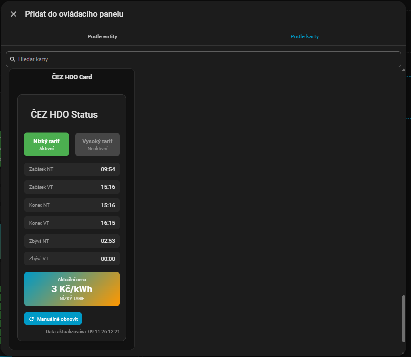
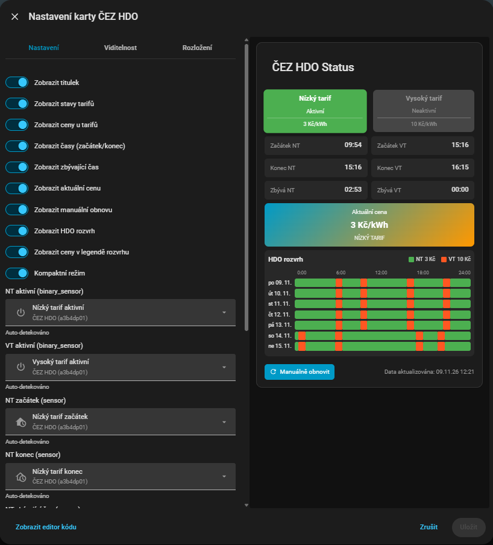
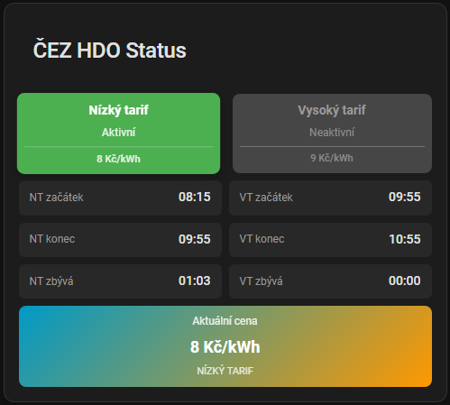
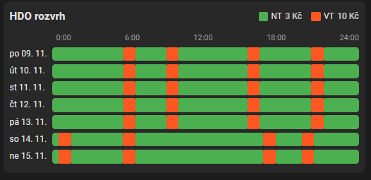

# ⚡️ČEZ HDO pro Home Assistant ⚡️

[English](README_EN.md) · [Kompletní dokumentace ve Wiki](https://github.com/Cmajda/ha_cez_distribuce/wiki)

> **Neoficiální komunitní integrace.** Nejde o produkt společnosti ČEZ Distribuce.

Integrace načítá HDO rozvrhy ČEZ Distribuce do Home Assistantu a nabízí senzory
tarifů i Lovelace kartu.

## 📑 Obsah

- [⚙️ Co integrace dělá](#co-integrace-dela)
- [📚 Wiki](#-wiki)
- [🐛 Nahlášení chyby nebo vylepšení](#-nahlášení-chyby-nebo-vylepšení)
  - [🐛 Nahlásit chybu](#-nahlásit-chybu)
  - [💡 Navrhnout vylepšení](#-navrhnout-vylepšení)
  - [❓ Položit dotaz](#-položit-dotaz)
- [🤝 Spolupracovníci a přispěvatelé](#-spolupracovníci-a-přispěvatelé)
  - [👥 Spolupracovníci](#-spolupracovníci)
  - [🌱 Přispěvatelé](#-přispěvatelé)
- [🍺 Podpořit vývoj](#-podpořit-vývoj)
- [🚀 Rychlý start](#-rychlý-start)
- [🎴 Přidání karty](#-přidání-karty)
- [🏠 Lovelace karta](#-lovelace-karta)
- [📡 Vytvářené entity](#-vytvářené-entity)
- [📚 Dokumentace a podpora](#-dokumentace-a-podpora)

## ⚙️ Co integrace dělá

Pro zadané odběrné místo (EAN) a HDO signál načítá časy spínání nízkého a
vysokého tarifu. V Home Assistantu poskytuje:

- senzory aktuálního tarifu, začátků a konců tarifů a času do další změny;
- aktuální cenu z pevného nastavení nebo vybraného cenového senzoru;
- sedmidenní HDO rozvrh a senzory platnosti načtených dat;
- entity použitelné v automatizacích, například pro spínání spotřebičů podle tarifu;
- automatické a ruční obnovení HDO dat.

Senzor aktuální ceny lze přidat do Energy Dashboard pro přehled nákladů;
pro výpočet je potřeba také senzor spotřeby elektřiny.

## 📚 Wiki

Wiki je hlavním zdrojem podrobné dokumentace. Obsahuje návody k instalaci a
nastavení, přehled entit, příklady automatizací, práci s cenami a Energy
Dashboardem, řešení problémů i vývojářské informace.

[Otevřít českou Wiki](https://github.com/Cmajda/ha_cez_distribuce/wiki) ·
[English Wiki](https://github.com/Cmajda/ha_cez_distribuce/wiki/English-Home)

[Příklady automatizací podle tarifu](https://github.com/Cmajda/ha_cez_distribuce/wiki/User-Guide-CS#-automatizace-podle-tarifu)

## 🐛 Nahlášení chyby nebo vylepšení

### 🐛 Nahlásit chybu

[Vytvořit bug report](https://github.com/Cmajda/ha_cez_distribuce/issues/new?template=bug_report.yml) ·
[Postup včetně debug logů a diagnostiky](https://github.com/Cmajda/ha_cez_distribuce/wiki/Known-Issues-CS#jak-nahlásit-problém)

### 💡 Navrhnout vylepšení

[Vytvořit návrh vylepšení](https://github.com/Cmajda/ha_cez_distribuce/issues/new?template=feature_request.yml)

### ❓ Položit dotaz

[Vytvořit dotaz](https://github.com/Cmajda/ha_cez_distribuce/issues/new?template=question.yml) ·
[GitHub Discussions](https://github.com/Cmajda/ha_cez_distribuce/discussions)

## 🤝 Spolupracovníci a přispěvatelé

### 👥 Spolupracovníci

Děkuji všem, kteří se dlouhodobě podílejí na vývoji integrace:

<!-- readme: collaborators -start -->
<table>
   <tbody>
      <tr>
         <td align="center">
            <a href="https://github.com/pokornyIt">
               
                
               <b>pokornyIt</b>
            </a>
         </td>
         <td align="center">
            <a href="https://github.com/VojtechJurcik">
               
                
               <b>VojtechJurcik</b>
            </a>
         </td>
      </tr>
   </tbody>
</table>
<!-- readme: collaborators -end -->

### 🌱 Přispěvatelé

- [@jandado](https://github.com/jandado) – návrh omezení opakování OCR při HTTP 429
   a respektování `retryAfter` v [PR #86](https://github.com/Cmajda/ha_cez_distribuce/pull/86).

## 🍺 Podpořit vývoj

Pokud vám integrace pomáhá, můžete podpořit její další vývoj:

## 🚀 Rychlý start

1. V HACS otevřete **Integrations → Custom repositories** a přidejte
   `Cmajda/ha_cez_distribuce` jako integraci.
2. Nainstalujte **ČEZ HDO** a restartujte Home Assistant.
3. V **Nastavení → Zařízení a služby → Přidat integraci** vyhledejte
   **ČEZ HDO** a projděte nastavením EANu, CAPTCHA, signálu a cen.

[Podrobný návod k instalaci a konfiguraci](https://github.com/Cmajda/ha_cez_distribuce/wiki/User-Guide-CS)

## 🎴 Přidání karty

1. Otevřete dashboard a zvolte **Upravit dashboard → Přidat kartu**.
2. Vyhledejte **ČEZ HDO Card**, nastavte kartu a uložte ji.

Editor umožňuje zvolit zobrazené entity, ceny, časy, zbývající čas i kompaktní
režim. Rozvrh a ceny v jeho legendě lze zapnout podle potřeby.

## 🏠 Lovelace karta

Karta zobrazuje stav nízkého a vysokého tarifu, začátky a konce tarifů,
zbývající čas, aktuální cenu a volitelný sedmidenní HDO rozvrh. Data lze obnovit
ručně přímo z karty.

 

## 📡 Vytvářené entity

Každá instance vytváří entity pro své EAN a HDO signál. `*` označuje příponu
zvolenou při konfiguraci. Ikony odpovídají Material Design Icons použitým v kódu;
u platnosti dat se mění podle stavu.

| Ikona | Typ | Entita | Popis |
| --- | --- | --- | --- |
|  | Binary sensor | [`binary_sensor.cez_hdo_lowtariffactive_*`](https://github.com/Cmajda/ha_cez_distribuce/wiki/Entities-CS#lowtariffactive) | Nízký tarif je aktivní |
|  | Binary sensor | [`binary_sensor.cez_hdo_hightariffactive_*`](https://github.com/Cmajda/ha_cez_distribuce/wiki/Entities-CS#hightariffactive) | Vysoký tarif je aktivní |
|  /  | Binary sensor | [`binary_sensor.cez_hdo_data_valid_*`](https://github.com/Cmajda/ha_cez_distribuce/wiki/Entities-CS#datavalid) | Data jsou platná |
|  | Sensor | [`sensor.cez_hdo_lowtariffstart_*`](https://github.com/Cmajda/ha_cez_distribuce/wiki/Entities-CS#lowtariffstart) | Začátek NT |
|  | Sensor | [`sensor.cez_hdo_lowtariffend_*`](https://github.com/Cmajda/ha_cez_distribuce/wiki/Entities-CS#lowtariffend) | Konec NT |
|  | Sensor | [`sensor.cez_hdo_lowtariffduration_*`](https://github.com/Cmajda/ha_cez_distribuce/wiki/Entities-CS#lowtariffduration) | Zbývající čas NT |
|  | Sensor | [`sensor.cez_hdo_hightariffstart_*`](https://github.com/Cmajda/ha_cez_distribuce/wiki/Entities-CS#hightariffstart) | Začátek VT |
|  | Sensor | [`sensor.cez_hdo_hightariffend_*`](https://github.com/Cmajda/ha_cez_distribuce/wiki/Entities-CS#hightariffend) | Konec VT |
|  | Sensor | [`sensor.cez_hdo_hightariffduration_*`](https://github.com/Cmajda/ha_cez_distribuce/wiki/Entities-CS#hightariffduration) | Zbývající čas VT |
|  | Sensor | [`sensor.cez_hdo_currentprice_*`](https://github.com/Cmajda/ha_cez_distribuce/wiki/Entities-CS#currentprice) | Aktuální cena (Kč/kWh) |
|  | Sensor | [`sensor.cez_hdo_schedule_*`](https://github.com/Cmajda/ha_cez_distribuce/wiki/Entities-CS#schedule) | 7denní HDO rozvrh |
|  | Sensor | [`sensor.cez_hdo_raw_data_*`](https://github.com/Cmajda/ha_cez_distribuce/wiki/Entities-CS#rawdata) | Čas poslední aktualizace a surová data |
|  | Sensor | [`sensor.cez_hdo_data_valid_until_*`](https://github.com/Cmajda/ha_cez_distribuce/wiki/Entities-CS#datavaliduntil) | Platnost dat do |
|  | Sensor | [`sensor.cez_hdo_data_age_days_*`](https://github.com/Cmajda/ha_cez_distribuce/wiki/Entities-CS#dataagedays) | Stáří dat ve dnech |
|  /  /  | Sensor | [`sensor.cez_hdo_days_until_expiry_*`](https://github.com/Cmajda/ha_cez_distribuce/wiki/Entities-CS#daysuntilexpiry) | Dní do vypršení platnosti |

Například přípona `doma` vytvoří ID `sensor.cez_hdo_lowtariffstart_doma`.

## 📚 Dokumentace a podpora

- [Česká Wiki](https://github.com/Cmajda/ha_cez_distribuce/wiki)
- [Anglická Wiki](https://github.com/Cmajda/ha_cez_distribuce/wiki/English-Home)
- [Vydání a testovací verze](https://github.com/Cmajda/ha_cez_distribuce/releases)
- [Licence](LICENSE)
