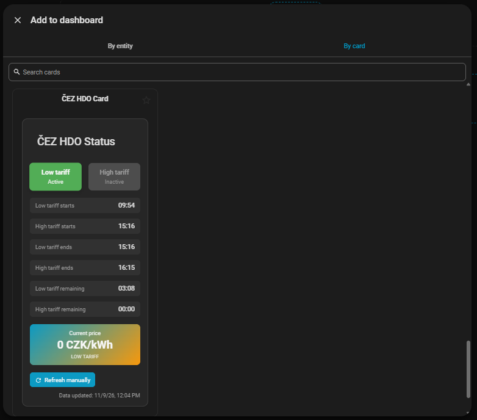
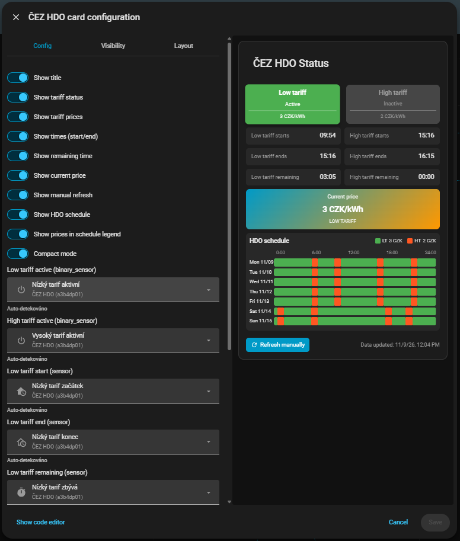
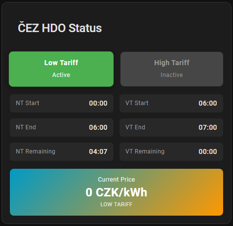
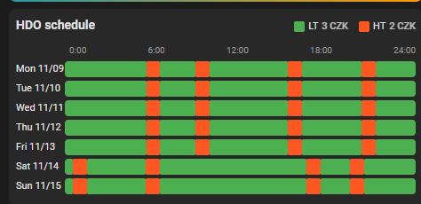

# ČEZ HDO for Home Assistant

[Čeština](README.md) · [Full documentation on the Wiki](https://github.com/Cmajda/ha_cez_distribuce/wiki/English-Home)

> **Unofficial community integration.** This is not a ČEZ Distribuce product.

The integration brings ČEZ Distribuce HDO schedules into Home Assistant with
tariff sensors and a Lovelace card.

## 📑 Contents

- [⚙️ What the integration does](#what-the-integration-does-section)
- [📚 Wiki](#-wiki)
- [🐛 Report a bug or request an improvement](#-report-a-bug-or-request-an-improvement)
  - [🐛 Report a bug](#-report-a-bug)
  - [💡 Request an improvement](#-request-an-improvement)
  - [❓ Ask a question](#-ask-a-question)
- [🤝 Collaborators and Contributors](#-collaborators-and-contributors)
  - [👥 Collaborators](#-collaborators)
  - [🌱 Contributors](#-contributors)
- [🍺 Support Development](#-support-development)
- [🚀 Installation](#-installation)
- [🎴 Add the card](#-add-the-card)
- [🏠 Lovelace card](#-lovelace-card)
- [📡 Created entities](#-created-entities)
- [📚 Documentation and support](#-documentation-and-support)

## ⚙️ What the integration does

For a configured metering point (EAN) and HDO signal, the integration fetches
the switching schedule for low and high tariffs. It provides:

- sensors for the active tariff, tariff start/end times, and time until change;
- the current price from a fixed value or a selected price sensor;
- a seven-day HDO schedule and data-validity sensors;
- entities that can be used in automations, for example to switch appliances
   based on the active tariff;
- automatic and manual HDO data refresh.

Add the current-price sensor to the Energy Dashboard for cost tracking; an
electricity consumption sensor is also required.

## 📚 Wiki

The Wiki is the main source of detailed documentation. It covers installation
and setup, entities, automation examples, prices and the Energy Dashboard,
troubleshooting, services, upgrades, and development.

[Open the English Wiki](https://github.com/Cmajda/ha_cez_distribuce/wiki/English-Home) ·
[Česká Wiki](https://github.com/Cmajda/ha_cez_distribuce/wiki)

[Tariff-based automation examples](https://github.com/Cmajda/ha_cez_distribuce/wiki/User-Guide-EN#-tariff-based-automations)

## 🐛 Report a bug or request an improvement

### 🐛 Report a bug

[Template chooser](https://github.com/Cmajda/ha_cez_distribuce/issues/new/choose) ·
[Guide to debug logs and diagnostics](https://github.com/Cmajda/ha_cez_distribuce/wiki/Known-Issues-EN#how-to-report-an-issue)

### 💡 Request an improvement

[Template chooser](https://github.com/Cmajda/ha_cez_distribuce/issues/new/choose)

### ❓ Ask a question

[Template chooser](https://github.com/Cmajda/ha_cez_distribuce/issues/new/choose) ·
[GitHub Discussions](https://github.com/Cmajda/ha_cez_distribuce/discussions)

## 🤝 Collaborators and Contributors

### 👥 Collaborators

Thanks to everyone who contributes to the integration:

<!-- readme: collaborators -start -->
<table>
   <tbody>
      <tr>
         <td align="center">
            <a href="https://github.com/pokornyIt">
               
                
               <b>pokornyIt</b>
            </a>
         </td>
         <td align="center">
            <a href="https://github.com/VojtechJurcik">
               
                
               <b>VojtechJurcik</b>
            </a>
         </td>
      </tr>
   </tbody>
</table>
<!-- readme: collaborators -end -->

### 🌱 Contributors

- [@jandado](https://github.com/jandado) – proposed limiting OCR retries on HTTP 429
   and honoring `retryAfter` in [PR #86](https://github.com/Cmajda/ha_cez_distribuce/pull/86).

## 🍺 Support Development

If you find the integration useful, you can support its continued development:

## 🚀 Installation

1. In HACS, open **Integrations → Custom repositories** and add
   `Cmajda/ha_cez_distribuce` as an integration.
2. Install **ČEZ HDO** and restart Home Assistant.
3. Go to **Settings → Devices & Services → Add Integration**, search for
   **ČEZ HDO**, and enter your EAN, CAPTCHA, signal, and tariff prices.

[Detailed installation and setup guide](https://github.com/Cmajda/ha_cez_distribuce/wiki/User-Guide-EN)

## 🎴 Add the card

1. Open a dashboard and select **Edit dashboard → Add card**.
2. Search for **ČEZ HDO Card**, configure it, and save.

The editor lets you choose entities, prices, displayed times, remaining time,
and compact mode. Enable the schedule and its price legend as needed.

## 🏠 Lovelace card

The card can show low/high tariff status, start and end times, remaining time,
the current price, and an optional seven-day HDO schedule. Data can also be
refreshed manually from the card.

 

## 📡 Created entities

Each integration instance creates entities for its EAN and HDO signal. `*` is
the suffix selected during setup. Icons match the Material Design Icons used in
the code; the data-validity icons change with the entity state.

| Icon | Type | Entity | Description |
| --- | --- | --- | --- |
|  | Binary sensor | [`binary_sensor.cez_hdo_lowtariffactive_*`](https://github.com/Cmajda/ha_cez_distribuce/wiki/Entities-EN#lowtariffactive) | Low tariff is active |
|  | Binary sensor | [`binary_sensor.cez_hdo_hightariffactive_*`](https://github.com/Cmajda/ha_cez_distribuce/wiki/Entities-EN#hightariffactive) | High tariff is active |
|  /  | Binary sensor | [`binary_sensor.cez_hdo_data_valid_*`](https://github.com/Cmajda/ha_cez_distribuce/wiki/Entities-EN#datavalid) | Data is valid |
|  | Sensor | [`sensor.cez_hdo_lowtariffstart_*`](https://github.com/Cmajda/ha_cez_distribuce/wiki/Entities-EN#lowtariffstart) | NT start time |
|  | Sensor | [`sensor.cez_hdo_lowtariffend_*`](https://github.com/Cmajda/ha_cez_distribuce/wiki/Entities-EN#lowtariffend) | NT end time |
|  | Sensor | [`sensor.cez_hdo_lowtariffduration_*`](https://github.com/Cmajda/ha_cez_distribuce/wiki/Entities-EN#lowtariffduration) | NT remaining time |
|  | Sensor | [`sensor.cez_hdo_hightariffstart_*`](https://github.com/Cmajda/ha_cez_distribuce/wiki/Entities-EN#hightariffstart) | VT start time |
|  | Sensor | [`sensor.cez_hdo_hightariffend_*`](https://github.com/Cmajda/ha_cez_distribuce/wiki/Entities-EN#hightariffend) | VT end time |
|  | Sensor | [`sensor.cez_hdo_hightariffduration_*`](https://github.com/Cmajda/ha_cez_distribuce/wiki/Entities-EN#hightariffduration) | VT remaining time |
|  | Sensor | [`sensor.cez_hdo_currentprice_*`](https://github.com/Cmajda/ha_cez_distribuce/wiki/Entities-EN#currentprice) | Current price (CZK/kWh) |
|  | Sensor | [`sensor.cez_hdo_schedule_*`](https://github.com/Cmajda/ha_cez_distribuce/wiki/Entities-EN#schedule) | 7-day HDO schedule |
|  | Sensor | [`sensor.cez_hdo_raw_data_*`](https://github.com/Cmajda/ha_cez_distribuce/wiki/Entities-EN#rawdata) | Last update time and raw data |
|  | Sensor | [`sensor.cez_hdo_data_valid_until_*`](https://github.com/Cmajda/ha_cez_distribuce/wiki/Entities-EN#datavaliduntil) | Data valid until |
|  | Sensor | [`sensor.cez_hdo_data_age_days_*`](https://github.com/Cmajda/ha_cez_distribuce/wiki/Entities-EN#dataagedays) | Data age in days |
|  /  /  | Sensor | [`sensor.cez_hdo_days_until_expiry_*`](https://github.com/Cmajda/ha_cez_distribuce/wiki/Entities-EN#daysuntilexpiry) | Days until expiry |

For example, the suffix `home` creates the ID `sensor.cez_hdo_lowtariffstart_home`.

## 📚 Documentation and support

- [English Wiki](https://github.com/Cmajda/ha_cez_distribuce/wiki/English-Home)
- [Česká Wiki](https://github.com/Cmajda/ha_cez_distribuce/wiki)
- [Releases and pre-releases](https://github.com/Cmajda/ha_cez_distribuce/releases)
- [License](LICENSE)
